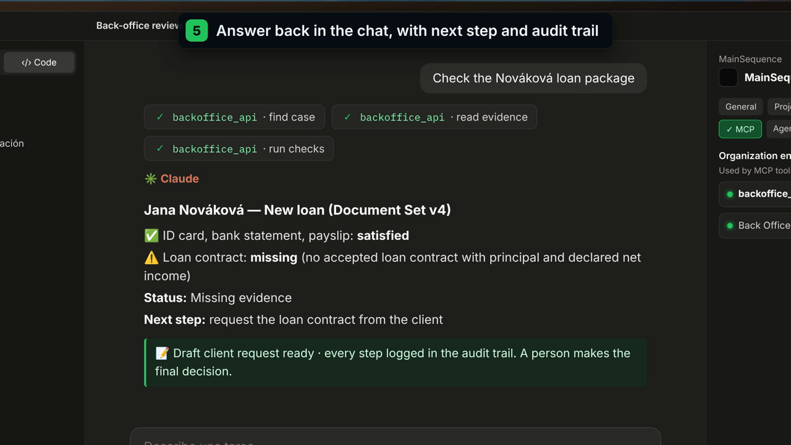

# Back-office document controls · Komerční banka (Track 6)

[](docs/demo/kb-final-demo.mp4)

## How it works

1. 👩‍💼 **Reviewer asks** in the assistant they already use (Claude, Copilot, ChatGPT), connected via MCP.
2. 📂 **Agent reads the package**: recognises each document type and pulls out the key data, with page citations and confidence.
3. ⚖️ **Bank rules check it**: complete per the Contract? consistent across documents? Clear status and next step.
4. 🧑‍⚖️ **A person decides the exceptions**: cited control protocol, every step logged. AI suggests, people decide.

## Results (synthetic Czech packages)

- Never approved a package it should have stopped: **26/26**
- Caught **13/13** planted problems (test set)
- About **15 s** and **~$0.20** per package
- Processed in the EU · GDPR

## Repositories

| Repo | Role |
|---|---|
| **BackofficeBackend** (this repo) | Business API, cases, reviews, audit and MCP tools on Main Sequence |
| [BackofficeFrontEnd](https://github.com/mainsequence-projects/BackofficeFrontEnd) | Command Center app and agent chat |
| [ParsingMotorBackend](https://github.com/mainsequence-projects/ParsingMotorBackend) | Document engine on AWS (EU): classify, extract, rules, cited protocol |

All demo data is synthetic. No real client data is used.

---

## Development

Use Python 3.13+ and the committed dependency lock:

```bash
uv sync --locked
uv run metatables copy-metatables-skills --path .
uv run pytest -q
uv run ruff check src/backoffice api scripts tests
uv run ruff format --check src/backoffice api scripts tests
uv run python -m scripts.export_contracts --check
```

After editing models or table metadata, regenerate the artifacts:

```bash
uv run python -m scripts.export_contracts
```

The companion static-site repository provides **Back Office: local stack** in
VS Code. Its launcher starts local MetaTables, explicitly applies local migrations,
and runs this API through [scripts/local_api.py](scripts/local_api.py). The local
worker and developer-session adapters remain outside deployable `api/` entry points.

## Documentation

- [Shared document engine, loan facts and opt-in parser evidence contracts](docs/shared-document-engine.md)
- [ADR 0001: Back Office helper, full MCP surface and document processing](docs/adr/0001-back-office-helper-mcp-and-document-processing.md)
- [ADR 0002: Automatic deployment of the agent using only MCP tools](docs/adr/0002-automatic-deployment-of-mcp-only-helper-agent.md)
- [Back Office helper configuration, deployment and verification](docs/agent.md)
- [Business API, permissions and operational contracts](docs/api.md)
- [Implemented MCP query tools and missing requirements](docs/mcp.md)
- [Namespace creation, workload roles and deployment](docs/namespace-workflow.md)
- [Foundation implementation and migration guide](docs/foundation.md)
- [Generated model reference](docs/model-reference.md)
- [Generated MetaTable dictionary](docs/metatable-dictionary.md)
- [Accepted project plan and target folders](docs/project-plan.md)
- [Business document catalog and intended checks](docs/document-catalog.md)
- [Main Sequence, API, MCP, and Tau contracts](docs/platform-contracts.md)

The companion `backofficefrontend` repository owns the Command Center application,
agent chat integration, and user guide. It consumes the documented business API.

## API discovery

The business [api/app/main.py](api/app/main.py) retains Main Sequence request identity.
Deployable FastAPI applications stay at `api/<name>/main.py` so CodeRepository
resource discovery can identify their entry points. Importing models, exporting
schemas, and starting this API do not migrate tables.

- [ADR 0003: Parsing workflow and per-type classification thresholds](docs/adr/0003-document-parsing-workflow-and-classification-policy.md) documents dynamic policies and automatic acceptance.

- [Bucket-backed document extraction](docs/document-processing.md): upload, classify, extract and apply per-type acceptance policies.

- [ADR 0004: Explicit cases and pinned Document Sets](docs/adr/0004-explicit-business-cases.md) documents business types, migration and the shared loan/account-opening engine.
- [Case ontology and workflow](docs/cases.md) explains subjects, staff, policies, evidence and evaluations.
- [Casework agent skill](.tau/skills/backoffice-casework/SKILL.md) guides analysis and authorized case building on the shared engine; see [ADR 0006](docs/adr/0006-case-building-mcp-workflow.md).
