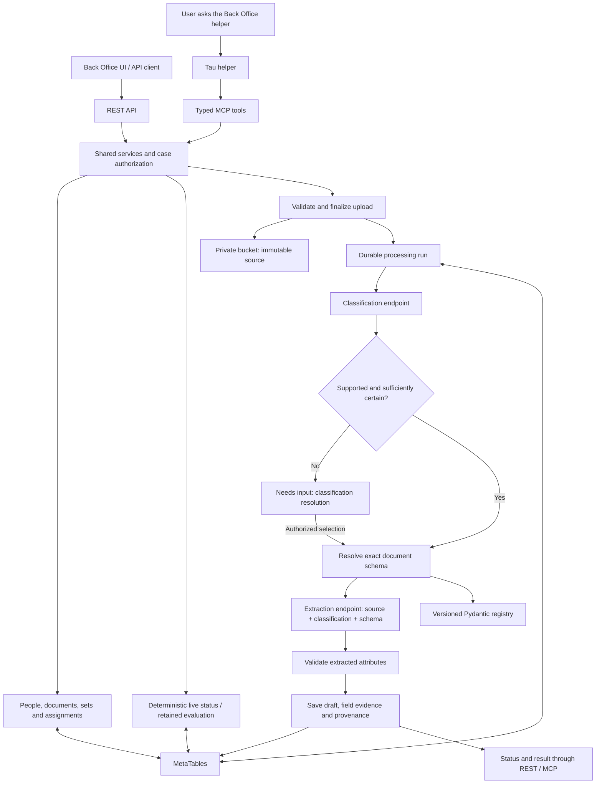
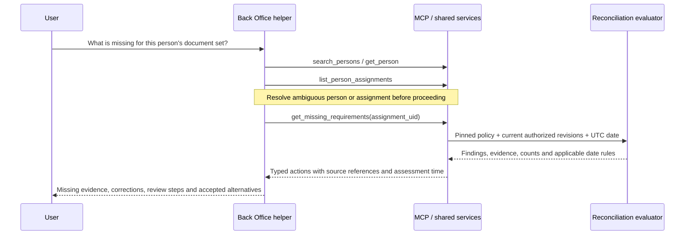

# ADR 0001: Shared REST and MCP services for the Back Office helper

- Date: 2026-10-19
- Status: Accepted direction; read-only person/set/assignment MCP queries and missing-requirement assessment implemented. Remaining catalog and processing work pending.
- Scope: Backend business services, REST API, MCP tool catalog, and helper behavior.
- Partially superseded by: [ADR 0003](0003-document-parsing-workflow-and-classification-policy.md) for per-type classification-confidence policies and validated automatic acceptance. The helper remains read-only.
- Supersedes: The proposed MCP interface table in [platform contracts](../platform-contracts.md) and the MetaTables-only raw-content target in [project plan](../project-plan.md). Existing chunk storage remains supported during transition.

## Context

The Back Office helper must answer questions about people, their documents, assigned
document sets, and outstanding requirements. It must also receive a document, store
the original in a bucket, classify it through one endpoint, and send the document,
classification, and document-type attribute schema to a second endpoint for extraction.
The same processing capability must be available to a user uploading through the API.

The current backend already implements authenticated person/case access, versioned
document contracts, chunked source uploads, drafts, submission, reviewer decisions,
assignments, reconciliation, audit history, and mutation recovery. The current working
tree also exposes live assignment status through `GET /assignments/{uid}/status`.
The first ten read-only MCP queries are now implemented; see the
[MCP query reference](../mcp.md) for the delivered subset and validation. Bucket
storage, classification/extraction adapters, and the helper runtime remain pending.

Terminology matters:

- **User** is the verified Main Sequence caller. `get_current_user` identifies that caller.
- **Person** is the business profile whose case is being managed. Questions such as
  “What is this customer's missing documentation?” resolve to a `person_uid`.
- **Document set** is an immutable, versioned requirement definition.
- **Assignment** applies one exact document-set version to a person and selects the
  documents used as evidence. A person's other documents do not automatically belong to it.
- **Source** is the original immutable file. A **document** is its typed business
  representation with versioned attributes and review state.

## Decision

Build one shared application-service layer with thin REST and MCP adapters. The
Back Office helper uses these typed tools to query and execute authorized work;
the backend owns permissions, schemas, processing, and deterministic reconciliation.
Natural-language answers explain returned facts and cite their record references.
The agent does not independently decide whether policy requirements are satisfied.

Store new raw files in a private bucket and keep ownership, object references,
checksums, processing state, typed attributes, revisions, and evidence in MetaTables.
Expose document processing as one durable workflow. The classifier and extractor
are server-configured dependencies, not separate public tools that an agent must
manually orchestrate.

### Architecture

Endpoint clients deliver the same verified source bytes or a short-lived download
capability scoped to the exact object version. The bucket is never made public.

## Complete initial MCP surface and REST parity

The table records the full target catalog at decision time; the delivered read-only
subset is tracked in the [MCP query reference](../mcp.md). **Existing** means the REST route or business
operation exists in the inspected working tree, not that its MCP adapter exists.
**New** identifies new API/service behavior. **Extend** preserves an existing
operation while adding the contract described here. Route placeholders are illustrative
names for the same UID parameters in the API.

### Queries and requirement explanations

| MCP tool | REST equivalent | Inputs and result | API work |
| --- | --- | --- | --- |
| `get_current_user` | `GET /me` | Verified caller UID and reviewer capability; no arbitrary user lookup. | Existing |
| `search_persons` | `GET /persons` | `search`, `limit`, `offset`; accessible matching cases with stable UIDs. | Existing |
| `get_person` | `GET /persons/{uid}` | `person_uid`; reference profile and revision. | Existing |
| `get_person_schema` | `GET /person-schema` | Editable profile contract and field descriptions. | Existing |
| `list_document_types` | `GET /document-types` | Supported types and exact schema versions. | Existing |
| `get_document_schema` | `GET /document-types/{type}/schema?version=...` | Type/version; canonical and draft schemas. | Existing |
| `list_document_sets` | `GET /document-sets` | Published set versions; add bounded pagination and optional search. | Extend |
| `get_document_set` | `GET /document-sets/{key}/versions/{version}` | Exact published definition, conditions, alternatives, counts and date rules. | New |
| `list_person_assignments` | `GET /persons/{uid}/assignments` | Person and pagination; pinned set versions and assignment UIDs. | Existing |
| `get_assignment` | `GET /assignments/{uid}` | Assignment revision and selected document UIDs. | Existing |
| `list_person_documents` | `GET /persons/{uid}/documents` | Person and pagination; documents and current revision/review state. | Existing |
| `get_document` | `GET /documents/{uid}` | Latest document revision, payload, source references and effective review. | Existing |
| `list_document_revisions` | `GET /documents/{uid}/revisions` | Revision history; add explicit pagination rather than silent truncation. | Extend |
| `get_document_revision` | `GET /documents/{uid}/revisions/{revision}` | Exact retained revision and its effective review. | Existing |
| `list_document_reviews` | `GET /documents/{uid}/reviews` | Review history; add explicit pagination. | Extend |
| `list_person_sources` | `GET /persons/{uid}/sources` | Source manifests without file bytes. | Existing |
| `get_source_document` | `GET /source-documents/{uid}` | Manifest, readiness and upload progress; storage-independent shape. | Extend |
| `get_source_document_content` | `GET /source-documents/{uid}/content` | Authorized file download/resource, never an unbounded base64 tool result. | Extend |
| `get_document_set_status` | `GET /assignments/{uid}/status` | Fresh deterministic assessment of the assignment; no saved evaluation. | Extend |
| `get_missing_requirements` | `GET /assignments/{uid}/missing-requirements` | Actionable projection of the same fresh assessment, including alternatives and evidence. | New |
| `list_assignment_evaluations` | `GET /assignments/{uid}/evaluations` | Paginated retained evaluations. | Existing |
| `get_reconciliation_report` | `GET /evaluations/{uid}` | Frozen evaluation, findings and current `stale` flag. | Existing |
| `get_person_history` | `GET /persons/{uid}/history` | Paginated audit events with trusted actors and references. | Existing |
| `get_operation` | `GET /operations/{operation_key}` | Original caller's durable mutation status/result. | Existing |

The helper resolves ambiguous names with the user before selecting a case or mutating
it. Multiple assigned sets are reported separately; it never silently chooses the
first assignment or substitutes the newest catalog version for the pinned version.
There is no arbitrary SQL, unrestricted organization-user directory, or generic
HTTP-request tool in this surface.

### Case and document commands

| MCP tool | REST equivalent | Required business input and effect | API work |
| --- | --- | --- | --- |
| `create_person` | `POST /persons` | Profile and operation key; create a case owned by the verified caller. | Existing |
| `update_person` | `PUT /persons/{uid}` | Replacement profile, expected revision and operation key. | Existing |
| `assign_document_set` | `POST /persons/{uid}/document-sets` | Exact set key/version and operation key. | Existing |
| `set_assignment_documents` | `PUT /assignments/{uid}/documents` | Complete selected UID list, expected revision and operation key; initially add-only as today. | Existing |
| `register_document` | `POST /persons/{uid}/documents` | Type/version, draft payload, ready source references and operation key. | Existing |
| `update_document_draft` | `PATCH /documents/{uid}/draft` | Replacement payload/sources, expected revision and operation key; append a revision. | Existing |
| `submit_document_revision` | `POST /documents/{uid}/submit` | Expected revision and operation key; canonical validation and submission. | Existing |
| `evaluate_document_set` | `POST /assignments/{uid}/evaluations` | Expected assignment revision and operation key; save a frozen evaluation. | Existing |
| `resume_operation` | `POST /operations/{operation_key}/resume` | Replay the original caller's validated durable mutation plan. | Existing |

`POST /documents/{uid}/revisions` currently saves a draft revision; it is not the
submission route. This ADR corrects that mapping from the previous interface plan.
Queries do not implicitly invoke these commands. Extraction does not overwrite the
person's reference profile, submit a draft, or add it to an assignment automatically.
After extraction, the helper may offer or execute explicitly requested assignment
and submission actions using their separate revision-checked commands.

Reviewer decisions remain available through `POST /documents/{uid}/reviews` to
authorized reviewers. `review_document` is excluded from the initial helper's MCP
catalog, even when the caller can review. A future reviewer-assistant decision must
define its human decision interaction before exposing that tool. The helper can
explain pending or rejected reviews through the read tools.

### Upload and processing commands

| MCP tool | REST equivalent | Inputs and result | API work |
| --- | --- | --- | --- |
| `start_document_upload` | `POST /source-documents/uploads` | Person, filename, media type, byte count, SHA-256 and operation key; source UID and bounded transfer instructions. | Extend |
| `upload_document_chunk` | `PUT /source-documents/uploads/{uid}/chunks/{index}` | Bounded base64 chunk; identical writes are idempotent by source/index/content. | Extend |
| `finalize_document_upload` | `POST /source-documents/uploads/{uid}/finalize` | Source UID and operation key; verify complete bucket object and mark ready. | Extend |
| `process_document` | `POST /source-documents/{uid}/process` | Ready source UID and operation key; start classification and extraction, return run UID/status. | New |
| `get_document_processing_run` | `GET /document-processing-runs/{uid}` | Stage, progress, classification, validation issues, result references and retryability. | New |
| `list_document_processing_runs` | `GET /source-documents/{uid}/processing-runs` | Source UID and pagination; recover/discover runs for that source. | New |
| `resolve_document_classification` | `POST /document-processing-runs/{uid}/classification` | Selected supported type, expected run revision, reason and operation key; resume a run waiting for input. | New |
| `retry_document_processing` | `POST /document-processing-runs/{uid}/retry` | Expected run revision and operation key; retry a recoverable failed stage using saved inputs. | New |

The original attachment is transferred by the host's attachment/upload integration,
using bounded upload tools or an authorized upload capability. A chat attachment or
local path is not automatically a remotely readable file. Do not pass a large file
through the language model context or accept arbitrary client-selected URLs/bucket keys.
The advertised tool catalog must match the actual host's file-transfer capabilities.

Add `POST /document-processing` as an API convenience route accepting a multipart
file, `person_uid` and operation key. It composes the same upload/finalize/process
services and returns `202 Accepted`, source UID, run UID and status URL after a
verified upload and durable processing intent. This is one user-facing “Upload and
extract” action; no duplicate extraction implementation is introduced. The existing
1 MiB JSON-body middleware must gain a bounded streaming path for this route. Keep
the current 10 MiB file ceiling and supported PDF/PNG/JPEG/text formats initially.

## Answering “What is missing?”

Use a live read for the default question, not a retained evaluation that may be stale:

`get_document_set_status` and `get_missing_requirements` must use the same
reconciliation implementation. The latter filters/enriches its result; it must not
create another policy engine. Its proposed response contains:

- Person and assignment UIDs, assignment/person revisions, pinned set key/version,
  evaluator version, evaluation date and `assessed_at` timestamp.
- Summary including mandatory/satisfied counts and `complete` from the evaluator.
- Requirement key, description, mandatory flag, applicability, status, reason code,
  accepted type/schema alternatives, required distinct count, qualifying count and
  shortfall where applicability is known.
- Missing field paths, exact document/revision/review references, source references
  when available, relevant expiration/freshness/renewal dates, and next actions.
- Scope of the assessment and any truncation/pagination information. A response
  must not imply that omitted assignments or documents were evaluated.

The current evaluator returns a primary blocking reason per requirement. It does
not enumerate every defect or expose every qualifying count. Implementation must
extend the shared evaluator's structured diagnostics when those details are needed;
the helper must not claim its current findings are an exhaustive defect list.
Fresh assessments must use a coherent revision snapshot or detect concurrent changes
and return a retryable conflict rather than combine mismatched inputs.

| Finding | Helper explanation / next action |
| --- | --- |
| `missing` | Upload enough distinct qualifying evidence; show alternatives as choices, not cumulative obligations. |
| `needs_information` | Identify missing profile/document fields, an unsubmitted draft, or unknown applicability. |
| `pending_review` | Evidence exists and needs a reviewer decision; do not ask for a duplicate upload. |
| `failed` | Explain the returned reason: rejection, mismatch, expiration, freshness, renewal, or duplicate evidence/period. |
| `not_applicable` | Explain the resolved condition; exclude it from mandatory outstanding work. |
| `satisfied` | Link the qualifying evidence; no missing action for this requirement. |

Example: “Identity is satisfied by passport revision 2. Address evidence is missing:
provide a utility bill or a bank statement meeting this set's date rules. Your payslip
is awaiting review. Residence-permit applicability needs a profile answer.” This is
an illustrative answer shape, not a statement about any actual person's records.

If no set is assigned, explain that there is no assigned policy to assess. Listing
available sets is read-only; assigning one is a separate command. Documents outside
an assignment may be suggested as candidates but do not count until explicitly linked.
Asking for a historical report uses `get_reconciliation_report`, identifies its
assessment date and `stale` flag, and does not present it as current status.

## Processing contract

### Stages and endpoint payloads

1. **Upload/finalize:** validate ownership, size, format and complete SHA-256;
   freeze the object version and source manifest before starting classification.
2. **Classify:** send the verified document reference/content, supported type IDs
   with descriptions, run/stage request ID and classifier contract version.
   Validate the returned type, candidates, optional confidence and provider provenance.
3. **Select schema:** resolve a server-owned exact version from the registry and
   pin its hash in the run. The classifier cannot define new attributes or versions.
4. **Extract:** send the same document, validated classification, selected type/version,
   and Pydantic-derived draft JSON Schema with field descriptions, nested definitions,
   formats and constraints. Supply canonical requiredness as completion metadata.
   Server-owned identifiers, actors, review state and workflow fields are excluded
   from the attributes the extractor may supply.
5. **Validate/persist:** validate the response against the pinned draft schema and
   source-bound evidence contract, then register one draft and its evidence through
   shared services. Return missing canonical fields and validation issues separately.
   A completed extraction may produce an incomplete draft; it is not accepted evidence.

Uncertain, unsupported or mixed-document classification enters `needs_input`. Initially
support one logical document per uploaded file; combined document packets require
separate uploads. A user may select a supported type for an ambiguous single document,
but cannot force an unsupported type or bypass mixed-file handling. Preserve both
the original classifier output and the authorized correction with its actor/reason.
Confidence thresholds are server configuration calibrated for the selected classifier;
missing confidence is not automatically success or failure.

Extraction responses carry attributes, missing/unreadable fields, warnings and optional
field-level page/region/excerpt evidence. Validate paths and page ranges against the
schema/source before persistence. Preserve provider/request identifiers and versions.
Do not manufacture values or citations. Malformed/invalid output is retained as a
restricted diagnostic with a validation failure; it is not silently saved as a valid
document. Canonical model validation remains mandatory at submission.

### Durable execution and retries

Use a background Job after persisting the processing intent. Persist separate run
status and stage: proposed statuses are `pending`, `running`, `needs_input`,
`completed`, `failed`, `cancelled`; stages cover classification, schema selection,
extraction, validation and persistence. `cancelled` is reserved for operational
termination; a public cancellation tool is outside the initial scope. Existing
processing-run constraints require an additive migration for `needs_input`.

Keep the source UID/hash/object version, initiating actor, person UID, pinned schema,
stage attempts/request IDs, job reference, run revision, classification, diagnostics
and resulting document/revision references. Use compare-and-set run revisions and
worker claim/lease ownership to prevent concurrent retries or late responses from
overwriting a resolved classification or completed result.

Reuse the original operation key and request body after an uncertain start response.
A deliberate retry of a recorded failed run is a separate idempotent command, and
reuses successful stage outputs. Derive stable per-stage keys; reconcile unknown
provider/job outcomes before resubmission where their interfaces support it. External
calls cannot be promised exactly once without provider support; persistence must
still create only one result draft for a run. Reprocessing after completion creates
a new run with explicit intent and preserves earlier evidence.

The existing processing-run table also stores short mutation intents and case-lock
records. Distinguish extraction runs by kind and typed input contract; do not feed
them into the generic mutation-plan replay path. Hold a per-person mutation lock
only while committing a short business mutation, never while uploading, waiting on
an external endpoint, or waiting for user input. Recheck authorized scope before
worker persistence. Emit structured retryable/permanent errors and retain the last
successful stage; a failed extractor does not require reuploading the source.

## Storage, authorization and compatibility

All tools use verified requester identity and existing case access. Person IDs select
records, not identities. Workload processing receives an explicitly authorized scope;
failed delegation does not fall back to broader workload access. Status/results,
history, downloads and retry commands enforce the same access boundary as writes.
Operation recovery remains restricted to its original actor. Record initiating actor
and executing workload separately in the processing audit trail.

Use private server-selected bucket locations with immutable object/version references.
Do not persist expiring URLs as evidence identity. Generate scoped download capabilities
only when needed, keep credentials and URLs out of tool results/logs where unnecessary,
and treat document text as untrusted evidence, never agent instructions. Endpoint URLs
and credentials are server configuration; agents cannot redirect documents to a URL
provided in a prompt. Provider-side OCR, or a bounded OCR adapter when required by
the endpoint contract, remains inside the processing service.

Preserve existing source UIDs and ready chunk-backed sources. Introduce a storage
adapter and additive source storage metadata so both old chunks and new bucket
objects can be read. Update upload/finalization/download code and source-schema
constraints intentionally; bucket uploads must not pretend to have legacy DB chunks.
The bounded chunk API may assemble a bucket upload without retaining permanent
duplicate chunk data. Track staged uploads so lost finalize responses are recoverable.
Cleanup of abandoned staging objects must not delete ready evidence. Historical
content migration or deletion requires a separate operational plan.

Mutations use operation keys and expected revisions where applicable. All collection
tools are bounded and explicitly paginated; adapters must not imply a truncated list
is complete. Publish typed input/output schemas, side effects, permission requirements,
stable error codes, retry semantics, and read-only/idempotency tool annotations that
match actual behavior. Preserve REST error meaning in MCP structured results.

## Alternatives considered

| Alternative | Decision and tradeoff |
| --- | --- |
| Agent calls classifier/extractor and manually saves results | Rejected: recovery, schema selection and validation would differ from the upload API. |
| Separate REST and MCP implementations | Rejected: duplicates access checks, policies and retry behavior. |
| Always run synchronously in the upload request | Rejected: processing duration and provider retries exceed a reliable request lifecycle. |
| Store all new file bytes in MetaTables chunks | Retain for compatibility only; bucket storage is the chosen target for originals. |
| Give the agent generic SQL or HTTP tools | Rejected for this helper: typed business operations preserve authorization and lifecycle rules. |
| Compute missing requirements in the language model | Rejected: shared deterministic evaluation provides reproducible, versioned evidence. |
| Automatically submit/accept extracted documents | Rejected: extraction produces a proposal; submission and reviewer decisions retain their existing semantics. |

## Consequences

The UI and helper produce consistent results and can recover long-running extraction
without resending the original file. Requirement explanations remain tied to exact
policies and evidence. The costs are bucket lifecycle management, background-worker
state, endpoint contract integration, and a larger typed API/tool catalog. A thin
agent runtime still needs workflow instructions, attachment transport integration,
and explicit evidence-based answer behavior.

## Implementation sequence and acceptance

The query/MCP subset of steps 1 and 4 is implemented locally. No deployment is
claimed; the remaining work follows this sequence.

1. **Contracts and queries:** finalize schemas/tool catalog, exact set lookup, query
   pagination, enriched live status and missing-requirement projection. Verify unknown
   applicability, alternatives, counts, dates, draft/review states, unassigned evidence,
   multiple assignments, stale reports and coherent concurrent reads.
2. **Storage:** introduce an additive migration and bucket adapter while preserving
   legacy sources. Verify bounded uploads, checksum/media validation, lost-response
   recovery, immutable objects, scoped downloads and unauthorized access denial.
3. **Processing:** implement classifier/extractor adapters and durable worker stages.
   Verify supported/uncertain/mixed classification, nested schemas, missing fields,
   malformed output, provenance, timeouts, duplicate delivery, worker restart, run
   races and exactly one persisted draft per run.
4. **MCP and helper:** bind all initial tools to shared services and verified requester
   identity through the actual MCP transport. Verify REST/MCP business-result parity,
   attachment transfer, query-only questions without mutations, correct case selection,
   prompt-like source text, review-tool exclusion and operation recovery.
5. **Integrated delivery:** exercise upload → bucket → classify → schema → extract →
   draft through both API and helper. Explicitly link/submit evidence, review through
   the existing reviewer flow, then ask what remains missing. Verify repeat queries
   reflect changed revisions and date-based validity without rewriting historical reports.

Before implementation binds external dependencies, resolve the bucket provider and
environment grants, classifier/extractor URLs and authentication, supported content
transport, OCR responsibility, timeout/retry contracts, confidence policy, data
retention and the host's attachment transport. These are configuration/integration
decisions; this ADR does not invent deployed endpoints or verified platform capabilities.

## Source references

- [Current REST API](../api.md) and [API implementation](../../api/app/main.py).
- [Shared business services](../../src/backoffice/services/application.py).
- [Reconciliation evaluator](../../src/backoffice/services/reconciliation.py).
- [Document registry](../../src/backoffice/schemas/registry.py) and [draft contracts](../../src/backoffice/schemas/drafts.py).
- [Source/evidence records](../../src/backoffice/tables/evidence.py) and [processing records](../../src/backoffice/tables/operations.py).
- [Platform and agent contracts](../platform-contracts.md) and [project plan](../project-plan.md).
