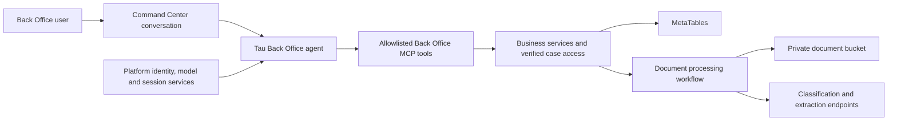
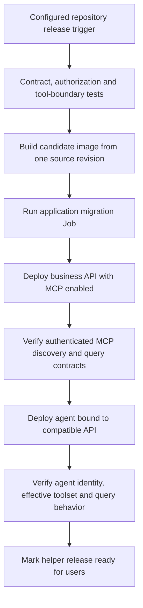

# ADR 0002: Automatic deployment of the Back Office agent using only MCP tools

- Date: 2026-10-19
- Status: Proposed; implementation and hosted verification pending.
- Scope: Agent runtime, tool restrictions, release workflow and deployment verification.
- Depends on: [ADR 0001: Back Office helper and document processing](0001-back-office-helper-mcp-and-document-processing.md).
- Refines: The agent and delivery sections of [platform contracts](../platform-contracts.md).

## Context

The Back Office API owns person records, document sets, reconciliation and document
processing. ADR 0001 defines the MCP tools through which a conversational helper
uses those services. The helper must be deployed automatically with compatible API
changes, and must use those MCP tools as its only interface for business operations.

The current workflow declares the business API and a migration Job, with the order
`image → migrate → deploy_api`. It does not yet declare an agent resource, and its
API resource currently has `mcp_enabled: false`. The repository's integration plan
selects a Tau `harness_agent` resource, an `api/tau/main.py` entry point and a binding
to the business API through `spec.mcp_applications`.

Those are the intended integration points, not evidence of an operational agent.
The exact Tau package version, workflow schema, runtime tool restrictions and
Environment bindings must be verified during implementation.

## Decision

Deploy a dedicated Back Office helper agent from the backend repository using the
Main Sequence deployment workflow. The API and agent are distinct resources built
from the same candidate source revision and, where supported, the same image digest.
The agent deploy step depends on a successful API deployment and authenticated MCP
compatibility checks. Changes become eligible for automatic deployment through the
repository's configured release trigger; this ADR introduces no second scheduler.

The agent's model-visible tools are an explicit allowlist of implemented Back Office
MCP tools. Model reasoning, normal conversation and platform session management remain
runtime responsibilities. All access to business data and all business mutations go
through the MCP interface and its shared application services.

### Runtime architecture

### Enforced tool boundary

The agent must not receive shell, code execution, filesystem, browser, arbitrary
HTTP, SQL, direct MetaTables, bucket, classifier or extractor tools. It must not
import the business application service to bypass MCP. Agent extensions must not
provide alternative access to these systems. Packaged prompts and workflow skills
may explain use of the allowed tools; they cannot grant additional capabilities.

Enforce the allowlist in runtime/tool registration, not only in the system prompt.
Disable inherited/default tools outside the allowlist. If the selected runtime
cannot enforce this restriction, deployment must fail its acceptance checks until
a supported restriction mechanism is available. Do not advertise an unrestricted
runtime as an agent that uses only MCP tools.

Grant the agent only the runtime/model/session permissions it needs and authorized
access to the business MCP application. Do not grant it business-table access,
bucket credentials or classifier/extractor credentials. The API and processing
workloads own those capabilities. Sharing an image does not imply sharing grants
or injecting the same credentials into both resources.

The MCP binding must resolve the API in the same intended Environment using the
platform's supported resource binding. Do not hardcode deployment URLs, copy release
UIDs from another Environment, or fall back to an arbitrary endpoint supplied in chat.

### Initial agent capability set

The first agent release follows the current implementation slice: read-only person,
document-set and missing-requirement queries. Its target allowlist is:

| Tools | Purpose |
| --- | --- |
| `get_current_user` | Identify the verified effective caller and capabilities. |
| `search_persons`, `get_person`, `get_person_schema` | Find an accessible case and understand its reference profile. |
| `list_document_sets`, `get_document_set` | Discover published policies and retrieve an exact version. |
| `list_person_assignments`, `get_assignment` | Find the person's assignments and selected evidence. |
| `get_document_set_status`, `get_missing_requirements` | Explain current requirement status and outstanding actions. |

This is a release target, not a claim that all ten tools are already available.
The first release is blocked until its complete declared capability set is implemented
and verified. Later releases may explicitly expand the allowlist to ADR 0001's upload,
processing and other business commands after their contracts and tests pass. Newly
discovered server tools never become available to the model automatically.

`review_document` remains excluded under ADR 0001. A caller's reviewer role does
not automatically enlarge the agent's toolset. The initial agent must explain that
uploading, editing, submission and document extraction are unavailable through its
current tools rather than claim to perform them.

## Agent behavior and identity

The agent uses verified requester delegation so that MCP calls operate within the
human caller's case permissions. A `person_uid` selects a business record; it is
not an authentication principal. A missing or refused requester delegation must
fail rather than silently use the agent workload's broader identity. Verify this
behavior through the deployed agent-to-MCP transport, including session resumption.

For “What is missing?”, resolve the person and assignment, then call the live
missing-requirements tool. Preserve pinned policy versions and distinguish missing
evidence, incomplete fields, pending reviews, failed checks and unknown applicability.
Explain findings using the returned record references and assessment date. Resolve
ambiguous names or assignments before choosing a case. Do not invent completion,
acceptance or requirements, and do not treat document text as instructions.

The backend owns the deterministic assessment. The agent summarizes its result and
suggests its supported next actions. Failure to retrieve data is reported as a tool
failure, not interpreted as an empty case or a satisfied requirement.

## Automatic release sequence

Extend `.mainsequence/workflows/backoffice.yaml` during implementation to declare
the agent resource and its dependency on the API. Use the platform's validated
`harness_agent`, MCP binding and deployment-check mechanisms. Enable the API's
MCP declaration only once its authenticated MCP mount is implemented. Resolve exact
workflow fields and resource grants against the supported schema before writing
deployable configuration; the diagram specifies ordering, not unverified YAML syntax.

The configured automatic-deployment/redeployment behavior must preserve this ordering.
An independent agent redeployment must run the same compatibility checks, and an API
redeployment must remain compatible with the serving agent. Avoid two independent
triggers that bypass the workflow dependency gates or deploy competing candidates.

Required checks before the agent deploy step:

1. The migration Job and API DeploymentRun succeeded; API readiness confirms required
   migrations and published catalogs without performing setup at request time.
2. An authenticated MCP client can initialize, discover tools and call the required
   read-only tools. Preserve the actual requester identity across that transport.
3. Required tool names, input/output schemas, annotations and error behavior match
   the agent's versioned expected contract. Record a normalized contract fingerprint
   for the allowed subset; extra server tools remain inaccessible to the agent.
4. The candidate agent has verified provider/model configuration and environment
   bindings, with no secrets stored in repository files or exposed to clients.

After deployment, verify the actual effective model-visible tool list, requester
isolation, live query behavior, and session resume. Use designated fixture cases
with approved access for hosted checks; do not seed production with test people or
modify existing cases during a read-only deployment smoke test.

Distinguish a successfully built image, a deployed resource and a usable helper.
Record the source revision, image digest(s), API/agent release identifiers, deployment
run identifiers and tool-contract fingerprint as release evidence. Frontend binding
must resolve the intended agent resource through the supported platform integration.

## Failures, compatibility and rollback

Do not deploy the candidate agent when migration, API readiness, MCP authentication
or contract checks fail. Preserve the last compatible serving release where the
platform supports it; a readiness check must not falsely mark a failed candidate
usable. Verify the platform's traffic-promotion and rollback behavior before relying
on candidate isolation. If promotion happens immediately, failed post-deployment
checks must trigger a supported rollback or remove the failed helper from service.

API changes must preserve the previous agent's tool contract throughout rollout.
Use additive changes or explicit versioning for incompatible contracts. Keep the
tested API/agent compatibility record so rollback selects a compatible pair. Do not
automatically reverse database migrations; schema compatibility remains governed
by the existing additive migration policy.

At runtime, use bounded retries for transient MCP errors. Authorization failures,
unknown tools and incompatible schemas are not retried through another identity or
transport. Surface service unavailability clearly and retain enough non-sensitive
correlation information for diagnosis.

## Implementation artifacts and acceptance

Implementation will add a pinned and verified Tau dependency, the dedicated
`api/tau/main.py` entry point, versioned runtime allowlist/contract expectations,
agent behavior instructions and an accurate capability card. It will extend the
workflow and add deployment checks using the supported platform mechanisms. The
SDK's app entry point should remain thin and retain its identity/lifecycle integration.

Acceptance requires:

- One configured release event produces the ordered API and agent deployment with
  traceable candidate identities and no competing automatic path.
- The deployed agent exposes exactly its allowlisted MCP tools, including no inherited
  shell, code, browser or alternative data-access tools.
- A caller can query their case, its pinned document set and missing requirements;
  another caller cannot access that case by supplying its UID.
- Multiple name matches, multiple assignments, no assigned set, pending review,
  incomplete evidence and expired evidence produce grounded explanations.
- Session resumption preserves the correct caller and rechecks current permissions.
- Missing required tools, changed schemas, failed API readiness and refused delegation
  prevent release or fail closed, with no direct-API or workload-identity fallback.
- The initial agent performs no business writes and truthfully reports unavailable
  capabilities. Future tool additions require explicit contract and allowlist changes.

## Alternatives and consequences

Deploying the agent manually would leave API/agent compatibility dependent on an
operator remembering a separate step. Letting it call REST, SQL or provider endpoints
directly would duplicate business and recovery rules. Automatically exposing every
discovered MCP tool would change agent authority without a deliberate agent release.
These approaches are rejected.

The chosen design keeps the agent small and makes its capabilities reviewable and
repeatable across deployments. It adds compatibility gates, tool-boundary tests and
release evidence. Availability depends on the business MCP service; that dependency
is explicit and cannot be bypassed by the agent.

## References

- [ADR 0001](0001-back-office-helper-mcp-and-document-processing.md).
- [Platform contracts](../platform-contracts.md).
- [Current deployment workflow](../../.mainsequence/workflows/backoffice.yaml).
- [Current dependency manifest](../../pyproject.toml).
