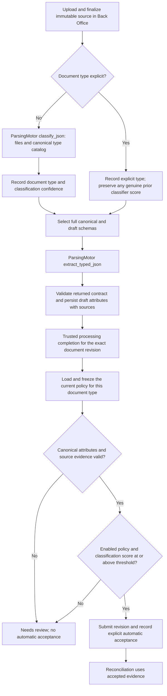

# ADR 0003: Document parsing workflow and per-type classification thresholds

- Status: Accepted
- Date: 2026-10-19
- Scope: BackofficeBackend; ParsingMotorBackend owns parsing, not business policy.
- Extends: [ADR 0001](0001-back-office-helper-mcp-and-document-processing.md).

## Context

ParsingMotorBackend has two independent endpoints: `/classify_json` discovers types
from a supplied canonical catalog; `/extract_typed_json` extracts one logical document
using an explicit type, schema version, checksum and full canonical/draft JSON Schemas.
Back Office owns canonical models, source storage, authorization, processing decisions
and document reviews.

The threshold measures **classification confidence**, not extraction quality or
required-field completeness. There is one confidence score for each document, and each
document type needs its own configurable threshold. For example, an administrator may
configure passports to be automatically accepted at 60% or above while setting a
higher threshold for bank statements. These are examples, not policies to seed silently.

The user separately confirmed in the Admin-section work that a qualifying result must
**automatically accept the exact document revision**. This supersedes ADR 0001's blanket
exclusion of automatic acceptance, subject to the validation and authorization gates below.

## Decision

### Workflow

Type classification, attribute extraction, and document acceptance are separate steps.
A classification score must never be represented as the accuracy of extracted fields.
An accepted document remains subject to the assigned document set's date, identity,
coverage and business rules; accepting it does not make the whole case complete.

Explicit-type extraction skips discovery. Reuse only a genuine classifier score for
the same source/document; if none exists, leave it missing. Do not manufacture 100%
confidence from an explicit user selection or a successful extraction.

### Document confidence

The completion contract stores one classification confidence percentage per exact
document revision. Back Office APIs use `[0,100]`; the parser uses `[0,1]`, so the adapter
must convert exactly once. Existing integer basis-point storage avoids floating-point
threshold comparisons: 6000 means 60%. Compare inclusively, with no rounding upward
that could promote a below-threshold result. Missing or nonfinite scores never pass.

The new discovery endpoint currently returns page results. For one logical multi-page
document, the adapter may derive one score as the minimum across its pages only when
all pages have the same supported type. Mixed or unknown types require resolution,
and incomplete/duplicate page results must not be represented as a classified document.
Preserve the page results and aggregation method with processing provenance. A legacy
parser document-level score can be used directly when its document/source binding is verified.

### One shared MetaTable policy

Use the new `backoffice.parsing_policy` MetaTable and `backoffice.parsing_result`
completion provenance introduced by the Admin-section implementation. Extend that
policy to be per document type; do not create a competing configuration store.
Physical names remain `backoffice__parsing_policy` and `backoffice__parsing_result`
in the existing `backoffice` namespace.

One policy row is one immutable revision for one canonical `document_type`:

| Field | Meaning |
| --- | --- |
| `uid` | Stable policy-version identity |
| `document_type` | Canonical discriminator, such as passport or bank_statement |
| `revision` | Positive revision within this type; independent of schema version |
| `automatic_acceptance_enabled` | Whether this type can be accepted automatically |
| `threshold_basis_points` | Inclusive cutoff from 0 to 10000; null only when disabled |
| `operation_key` | Unique idempotency key for publication |
| `changed_by`, `created_at` | Verified organization administrator and UTC publication time |

The latest revision **for the exact type** is current. Publishing requires the expected
current revision (`0` for an unconfigured type), appends history, and never overwrites
an earlier version. Disabling also publishes a revision. No type inherits another
type's threshold, and there is no implicit global default. Existing historical global
rows remain readable for provenance but cannot authorize new automatic acceptance.

A missing or disabled policy yields `needs_review`. A configured zero threshold is
valid but still requires an actual score and all validation gates. Store thresholds
in MetaTables, not environment variables, prompts, or worker constants. Read current
configuration for each new completion; do not cache it for the process lifetime.

### Authorization and API

Only verified organization administrators may read or change Admin settings. Reviewers
who are not organization admins cannot configure policy. Configuration APIs identify
the target document type explicitly, validate it against the canonical registry, and
reject unsupported types, out-of-range thresholds and enabled policies without a cutoff.

Only the trusted parsing processor or organization administrator may report completion.
Ordinary users and the read-only MCP helper cannot submit an authoritative score,
configure acceptance, or impersonate a processor. Keep actor and processing time server-owned.
Use the existing shared services and durable mutation path rather than browser-side decisions.

The settings/completion contracts retain idempotency keys and expected revisions.
Stale writes, reused keys with changed input, duplicate results and attempts to overwrite
an existing review must fail. An immutable result references the exact applied policy,
score, document revision and any automatic review, so later policy edits cannot change
historical decisions. Recovery reuses the recorded mutation plan and policy instead of
loading a newer threshold midway through a retry.

### Acceptance gates

The shared completion service evaluates all these gates:

1. The caller is an authorized processor or organization administrator.
2. The target is the exact latest revision, without an existing effective review/result.
3. The canonical Pydantic model validates the full extracted payload, including Python
   and cross-field validators that cannot be transmitted as JSON Schema.
4. Source references exist, are finalized and belong to the same person.
5. The exact document type has an enabled policy with a configured threshold.
6. A genuine classification score exists and meets that threshold inclusively.

Only then submit the valid draft if necessary and record an `accepted` review for that
revision with the actor, policy and score explanation. Otherwise record `needs_review`
with a stable reason. Never accept invalid attributes, absent evidence or a missing
score merely because a low threshold was configured. Later human reviews retain their
normal sequence/revision rules.

### Parsing, storage and durable execution

Send full schemas from `document_schema(type, version)` without flattening nesting,
arrays, descriptions, `$defs` or references. Map `content_sha256` to `schema_hash` and
`draft_schema` to `output_schema`. Validate returned type/version/hash before saving
attributes. The processor must bind classification and extraction to the same source
hash and exact resulting revision before it calls the completion service.

Retain source UID/hash, initiating actor, classifier output, document confidence,
aggregation method, schema identity, stage results and resulting draft references in
the processing run. Follow ADR 0001's durable worker design: no case lock while calling
the parser, reuse successful stages on retry, and persist one draft per run.

The existing finalized source API remains valid while bucket support is introduced.
Do not pretend that chunk-backed originals are bucket objects. Bucket transfer, parser
HTTP/SigV4 transport and job scheduling are separate integrations; this change delivers
the policy and its use at trusted processing completion, not those integrations.

## Migration and compatibility

Preserve the Admin implementation's new policy/result MetaTables and additive migration.
Evolve per-type scope without rewriting a revision already applied by another process.
Revision `backoffice_0003` creates the policy/result tables; `backoffice_0004` adds
nullable document-type scope and uniqueness per type/revision. Null types preserve
legacy global history only; the API requires a canonical type for every new policy.
The existing deployment migration Job applies application migrations before API rollout;
no startup migrations or direct hosted migrations. Verify locally using the installed
MetaTables client and a checked Local/SQLite runtime. Keep existing namespace grants.

Update the Admin client contract to identify a document type when editing its threshold.
Fail closed for old global policies; do not silently apply them to every document type.

## Alternatives and consequences

Hard-coded thresholds require redeployment and obscure historical decisions. A mutable
single row loses the policy used by earlier results. One global threshold cannot express
different confidence tolerances for passports and other documents. A parallel settings
table would create conflicting authorities. All four alternatives are rejected.

Automatic acceptance is now an explicit user-authorized capability, with strict
canonical/source validation and auditable provenance. Classification confidence remains
a provider estimate, and completeness is not a substitute for that confidence.

## Verification

Test passport/bank-statement isolation, exact threshold equality, below-threshold and
missing scores, zero/100 boundaries, disabled/missing policy, per-type revisions,
admin/processor access, invalid attributes, absent evidence, duplicate completions,
lost-response recovery, policy edits after earlier decisions, migration repeatability
and discoverable table metadata. Record offline, local API and hosted checks separately.

Local verification on 2026-10-19:

- 186 backend tests passed, including migration up/down/repeat, per-type acceptance,
  immutable decision recovery, strict input validation and gateway authorization.
- The pinned ten-tool helper contract check passed unchanged; generated contracts
  and application-code Ruff checks passed.
- The installed MetaTables client confirmed Local/SQLite source
  `fe037dd5-c954-5ea2-aaba-c3e1aa3c3a5b` in the isolated verification stack.
  Both new tables were discoverable and registered at `backoffice_0004`.
- The coordinated Admin UI/real API test passed on that same source: independent
  passport/utility-bill settings, reload persistence, concurrent-edit recovery,
  passport confidence `60.00` accepted at a `60.00` cutoff, and `59.99`/missing
  confidence requiring review. Test fixtures remain only in the isolated runtime.
- Hosted migrations, hosted database behavior and the external parsing transport
  have not been exercised by these checks.
