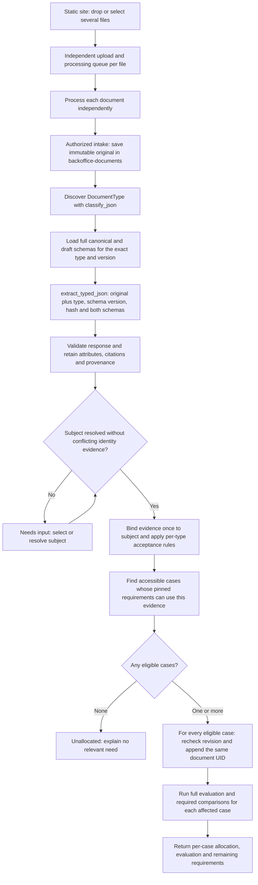

# ADR 0007: Automatic document intake, case allocation and reevaluation

- Status: Accepted; implemented locally, hosted rollout not verified.
- Date: 2026-10-19
- Extends: [ADR 0003](0003-document-parsing-workflow-and-classification-policy.md),
  [ADR 0004](0004-explicit-business-cases.md) and
  [ADR 0006](0006-case-building-mcp-workflow.md).
- Scope: Back Office orchestration, shared by REST and MCP, and a static-site file-drop screen.
  Implemented and verified locally; deployment is a separate release step.

## Context

The desired user action is “receive this document and put it in every case that needs
it.” The backend must store the original, discover its type, extract canonical
attributes, resolve its subject, find all relevant cases, link useful evidence and run
each complete case evaluation. The agent should invoke one durable business workflow
rather than independently reconstructing these steps.

DocumentType and CaseType are different concepts. A passport may be relevant to both
an account-opening case and a loan case. An extracted holder name identifies a
possible Person, not a Case. Case eligibility comes from the subject's cases and
each case's exact pinned Document Set, including alternatives and conditions.

Existing source records require a Person before extraction. Therefore unrestricted
“upload first, identify the subject afterward” needs an intake stage independent of
Person ownership. It cannot be implemented by temporarily assigning the source to
an arbitrary person or the requesting staff member.

## Decision

Implement one application-owned allocation service with strict Pydantic commands,
durable stages and bounded, structured results. REST and MCP delegate to it. The
backend owns identity resolution, eligibility, acceptance, linking and evaluation;
the parser returns observations and the helper explains returned outcomes.

The user confirmed two product decisions on 2026-10-19: identify the Person from
the document across all people accessible to the caller, asking when uncertain;
then automatically link the document to all eligible cases for that resolved Person.
Multiple eligible cases are expected and do not require another selection prompt.

### Workflow

User choices resume the same retained extraction. They do not cause an unnecessary
upload or extraction. No case is created implicitly when none is eligible.

### Static-site screen: Drop files

Add a dedicated **Drop files** screen to the existing Back Office static site,
accessible from its main navigation. The primary interaction is a large drag-and-drop
area with an accessible **Choose files** alternative supporting multiple selection.
Users do not need to select a Person, Case or DocumentType before dropping files.
Dropping or selecting supported files starts upload and processing automatically.

Each file is a separate intake and allocation run, with its own operation keys,
progress, results and retry action. Files in one drop may belong to different people;
resolve each independently. Do not combine the batch into one parser request or
infer shared ownership from a filename, folder or the other files in the batch.
One invalid, ambiguous or failed file must not block the other files.

Show a compact row for every file, including its name, upload progress and current
stage: queued, uploading, identifying type, extracting, resolving person, allocating,
evaluating, or finished. Clearly distinguish **Needs input**, **No eligible case**,
**Needs review**, **Partially completed** and **Failed** outcomes. Show the detected
type, resolved person, linked cases and links to their workspaces/evaluation results
when available. Keep document acceptance distinct from processing completion.

When identity is uncertain, the affected row offers a **Resolve person** action using
authorized candidates and backend diagnostics. Resume the same run after resolution.
Multiple eligible cases for a resolved person are linked automatically without a
case-selection dialog. Recoverable failures offer a per-file retry that reuses the
retained source and successful stages; retrying one row does not replay the batch.

The browser uses the shared intake/allocation API, with bounded concurrent uploads
and polling. Display supported formats and size limits from the API contract and
validate them on both client and server. Preserve stable operation/run references
across refreshes and provide an authenticated, paginated intake/run listing so users
can recover submitted work after navigation or a lost start response. Bytes not yet
uploaded may require reselection; never label an incomplete upload as received.
Once the backend acknowledges a durable run, processing continues without the page
remaining open. Do not persist document bytes or extracted attributes in browser
storage merely to restore the queue.

This screen is a frontend for the same backend workflow used by MCP. It contains no
independent matching, threshold, allocation or evaluation rules, and receives no
bucket credentials or parser secrets. Its delivery is part of this ADR's scope.

### Extraction and acceptance

Discovery precedes extraction when the type is unknown. Send the original document
and the full canonical and draft JSON Schemas, including nested definitions,
descriptions and required fields, to typed extraction. Do not send only a selected
list of field names. Keep required fields distinct from unknown extracted values;
the draft schema allows incomplete results to be retained honestly.

Reuse the current parser contracts and their source/page/schema binding checks.
Mixed-document packets, unsupported types or invalid provenance need resolution.
An explicit type, if supported by the final input contract, cannot manufacture a
classification score. Parser deployment compatibility is a release prerequisite.

Apply ADR 0003's per-type policy to the exact persisted document revision, including
canonical validation and all current source and extraction-evidence gates.
Classification confidence is neither identity-match confidence nor the probability
that a case is correct. Automatic allocation does not itself accept a document.
Evidence awaiting review can be linked when identity and allocation are resolved,
but it remains pending and cannot satisfy an accepted-evidence requirement.

### Subject resolution and case selection

1. Authorize the intake and constrain all searches to subjects/cases the effective
   requester may access. Search that accessible population using the extracted
   identity; a preselected subject is not required. Ask the user when the subject
   cannot be identified reliably. A privileged worker must not expand that scope.
2. Preserve an existing source owner as a constraint; conflicting extracted identity
   must produce a diagnostic instead of silently rerouting the document. Explicit
   single-case requests use the separate case workflow rather than this all-case tool.
3. Use documented, type-specific mappings from canonical extracted fields to
   reference Person attributes. Preserve original values and citations. Name-only
   or fuzzy matches produce candidates, not automatic ownership. The final matching
   rule must define corroborating evidence, missing fields and contradictions;
   exact name plus birth date alone is not assumed universally unique or sufficient.
4. Never overwrite the reference Person profile with extracted claims. Do not
   invent a Person or infer one from the uploader's authentication identity.
5. For a resolved subject, examine each accessible case's pinned requirements using
   shared evaluator logic: accepted types/schema versions, applicability, dates,
   distinct reporting periods, counts, existing evidence and reuse rules. Type
   membership alone does not prove that the case needs another document.
6. Return explicit eligibility reasons and affected requirement keys. Unknown
   applicability, identity conflicts and an incomplete candidate scan cannot yield
   a confident automatic allocation. An already satisfied alternative does not
   imply a need to upload every other allowed type. Existing evidence pending review
   does not by itself justify allocating another copy.
7. Automatically link the same subject-owned document to every eligible case for
   the resolved Person. Do not choose only the newest or first case, and do not
   create duplicate document records for different cases. Follow all candidate
   pages before freezing the target set; a bounded scan that cannot finish must
   report incomplete discovery rather than claim all eligible cases were handled.

Reuse requirement-assessment primitives for eligibility. Do not create a second
rule engine in an agent prompt or a parser. A useful pending-review document may
address a missing-evidence need without changing the final satisfaction count yet.
Assess existing pending evidence's potential coverage with the same field, date,
count and duplicate checks. One pending document does not hide a remaining count
shortfall. Rejected evidence is not automatically linked to another case. These
hypothetical coverage checks never persist acceptance or satisfy the actual review.

### Intake and evidence ownership

Create a durable intake record referencing the private bucket artifact, verified
uploader/requester, checksum, file metadata, operation key, stage, retained parser
results and resolution state. Before a subject is resolved it is visible only
through explicit intake authorization; unresolved material must not appear in a
person's document inventory or case workspace.

After resolution, materialize the normal subject-owned source/document through the
shared services while retaining the original artifact and immutable provenance.
Never mutate an existing source to transfer it between people. Stable stage keys
prevent duplicate sources and revisions after an uncertain response. If ownership
was already bound, resolving to a different subject requires a separate explicit
correction workflow, outside this operation.

Unresolved intake retains its private original under the existing bucket retention
policy. This release adds no automatic deletion or separate retention schedule.
Persistence/migration design must preserve existing non-null source ownership and
same-subject evidence constraints; adding nullable ownership to normal documents
is not an implicit part of this decision.

### REST and MCP surface

These operations are implemented by the shared allocation service.

| REST operation | MCP tool | Purpose |
| --- | --- | --- |
| `POST /document-intakes` | Upload transport described below | Receive original bytes and create private intake |
| `GET /document-intakes/config` | Not required | Read supported file formats and upload limits |
| `GET /document-intakes` | `list_document_intakes` | Recover the caller's authorized intake/run queue with pagination and processing references |
| `POST /document-allocations` | `allocate_document` | Start discovery, extraction, resolution, linking and evaluation for a finalized intake or an existing ready source |
| `GET /document-allocations/{uid}` | `get_document_allocation` | Read progress, candidates, decisions and resulting references |
| `POST /document-allocations/{uid}/resolve` | `resolve_document_allocation` | Resolve uncertain subject identity with an authorized selection and the observed allocation revision |
| `POST /document-allocations/{uid}/retry` | `retry_document_allocation` | Resume recoverable work without changing frozen inputs |

The upload API starts allocation automatically, so a normal UI upload starts the
whole process in one interaction. Its implementation invokes the same service.
The allocation command uses a discriminated input reference: exactly one finalized
intake UID or ready source UID and an operation key. A source owner constrains the
subject; this automatic workflow considers all eligible cases, with no case filter.
An existing source's owner is authoritative and cannot be overridden by a hint.
Caller identity, schema contents, scores and acceptance decisions are server-owned.

MCP receives an authorized persisted reference after the attachment/upload transport
has transferred the original. It must not treat attachment prose as original bytes,
accept arbitrary filesystem paths or fetch arbitrary URLs. To support direct binary
ingestion through MCP itself, specify a separate bounded upload/chunk contract and
release its helper permission deliberately; current MCP body limits cannot carry
a maximum-size document as one base64 tool argument. Providing only a reference
tool must not be described as implementing direct chat-attachment upload.

Start/retry return an asynchronous run reference. Polling distinguishes processing,
needs-input, unallocated, allocated/evaluating, completed and failed states. Results
include stage, stable reason codes, source/document revision, classification,
acceptance outcome, matching evidence, candidate cases, linked case IDs, evaluation
run/result IDs and outstanding requirements. Expose only authorized, bounded data;
the API must not return bucket credentials or internal provider payloads.
Paginate per-case outcomes where necessary and expose totals and continuation
information so the caller can verify that every target was considered.

### Durable linking and full review

Bind idempotency to requester, input identity/checksum and intended scope. Derive
distinct stage keys for binding, each case link and each evaluation. Replaying the
same command resumes the recorded work; changing its target with the same operation
key fails. User resolution is its own versioned command on that run.

Freeze and retain the discovered target-case IDs, eligibility reasons and input
revisions before fan-out. Track linking and evaluation separately for each target.
A retry resumes that target set instead of silently including cases created later;
a new allocation request can discover new cases while reusing existing evidence.
Authorization and current eligibility still require rechecking for each target.
Record a skipped outcome when a target no longer needs the evidence.

Recheck authorization, subject ownership, case membership revision and eligibility
immediately before linking. Append without removing existing evidence. If a case
changes, recompute eligibility against its current pinned policy and evidence;
never overwrite concurrent changes or silently select a different case.

Commit a durable evaluation obligation alongside the link so a crash after linking
cannot lose reevaluation. Evaluate the complete linked case using the existing
engine, including asynchronous comparisons where its policy requires them. Retain
historical evaluations; create a new result and publish it as current only for its
matching input snapshot. A stale result triggers bounded reevaluation or a visible
needs-input state rather than falsely reporting an up-to-date review.

Keep successful allocation visible if downstream evaluation fails. Retry evaluation
without re-uploading, re-extracting or duplicating membership. Concurrent duplicate
deliveries must not create duplicate logical evidence or inflate requirement counts.
Failure in one case must not undo successful links or suppress evaluation in the
other cases. Return partial progress and per-case errors; do not report complete
success while a target still has unfinished linking or evaluation work.
Reuse existing leases, checkpoints and mutation controls; do not hold person/case
locks during bucket, parser or comparison calls.

“Full review” here means complete automated requirement evaluation and configured
comparisons. It does not replace an outstanding human review, approve a loan, open
an account or close a case. Report evidence acceptance, allocation and case-check
completion separately.

### Helper release boundary

The new MCP mutations require explicit allowlist entries, truthful side-effect
annotations, reviewed pinned contracts, and coordinated skill guidance. Preserve
both Tau exclusion flags and verified-requester enforcement. The helper calls the
allocation service; it receives no direct database, bucket or parser access.
Documents and extracted text are evidence, never tool-execution instructions.

## Implementation decisions and limits

Reuse the existing ProcessingRun MetaTable for `document.allocate` intake records
and `allocation.request` retry receipts. Intake and allocation use the same UID.
This existing subject-independent record supports leases, frozen inputs and stage
checkpoints; no new table, migration or nullable source owner is needed. Binding
creates normal subject-owned evidence through the existing audited mutation service.

Matching version 1 requires a unique normalized exact holder name and corroborating
cited birth date or full address (street, city, postal code, country), with no
conflicting identity facts or disagreeing selected readings. Name-only and ambiguous
matches ask the user. Source bytes enter through multipart intake; the SDK's direct
FastAPI transport supports this in the static site. MCP receives a persisted
reference. Native assistant chat attachments remain unsupported by the installed SDK.

Workers refresh requester directory facts and cap access at submission privileges.
Discovery is bounded at 10,000 accessible subjects, 500 cases and 500 documents for
deduplication. An exceeded bound is an explicit failure, not partial discovery
presented as completion. Target results are paginated. Failures retain per-case
commands and outcomes for retry without losing successful allocations.

See [Document allocation](../document-allocation.md) for exact contracts and release
requirements. Local verification uses controlled parser and bucket adapters; a
compatible live parser deployment is still a separate prerequisite.

## Verification required

Test REST/MCP parity and strict request validation; delegated-requester isolation;
unique, absent, conflicting and ambiguous identity matches; allocation to all eligible
cases using a single document identity; paginated target discovery; partial fan-out
failure and retry without duplicate links; newly created cases after target freezing;
conditions/alternatives/counts/periods/schema compatibility; existing satisfied or
pending evidence; duplicates and mixed packets; threshold equality and failed
acceptance gates; stale membership and profile changes; unauthorized resolution;
lost responses and worker restarts at every stage; link-success/evaluation-failure
recovery; and asynchronous comparison results becoming stale during execution.

Verify the static-site screen with multiple files belonging to different people,
keyboard file selection, per-file progress and case links, invalid formats/oversize
files, mixed success/failure, uncertain-person resolution, bounded concurrency,
duplicate retries, refresh/navigation recovery and continued server-side processing
after the page closes. Verify that all eligible cases are shown and that pending
human review is not presented as successful case approval.

Run migration and workflow checks against isolated local MetaTables, the helper
contract gate and scoped tool tests, then verify compatible hosted parser endpoints
and the actual client attachment path. Do not equate a stubbed parser test with
deployed extraction or a saved proposal with an implemented feature.

## Local verification recorded 2026-10-19

- Backend regression suite: 354 tests passed. The subsequent pending-evidence/count
  correction passed all 14 focused API/MCP allocation tests, including duplicate
  sources, existing normal extraction reuse and concurrent document revision changes.
- The reviewed 35-tool MCP contract gate passed, with actual authenticated MCP tests
  for allocation, resolution, retries and private-queue access.
- Browser tests passed multi-file intake, independent invalid/ambiguous outcomes,
  identity resolution, multipart transport, refresh recovery and 320/768/1360-pixel
  layouts. Frontend production build and SDK theme audit passed.
- Installed MetaTables API/client verification passed on isolated Local/SQLite source
  `3262c8c3-c516-593d-b864-f8ca63e14482`, using the actual requester-directory lookup.
  One extracted fixture was linked to two cases and evaluated. A fresh client process
  verified the retained links and current evaluations. Bucket/parser adapters were
  controlled fixtures; no hosted deployment or live extraction success is claimed.

### Follow-up live verification and local dispatch correction

On the same date, the local browser exposed a pending intake: the developer API
was dispatching local SQLite run IDs to a hosted Job. The local API now installs
a bounded local worker queue for REST and MCP, verifies the pinned source before
execution and recovers durable pending/expired work. Hosted API dispatch is unchanged.
Provider calls persist visible classification/extraction stages before starting;
dispatch errors and review reasons remain visible after refresh.

A real API upload of `data/examples/01_happy_all7_A/id_card.pdf` completed using
the managed `backoffice-documents` bucket and deployed parser `6fd21155a633` with
v2 contracts. Run `e22fc980-cfc3-5017-ae88-ebcf612361ca` identified the example Person,
linked one document to both local test cases and completed both evaluations on
SQLite source `b3416a7c-8f80-5cc4-bd25-b07ff8f96018`. The document correctly remained
`needs_review/invalid_document_attributes`; processing completion did not bypass
canonical validation or claim case approval. The browser displayed the completed
case links and the original unresolved upload's explicit person-selection state.
This verifies real external bucket/parser calls with local orchestration, not a
hosted Back Office deployment.

Repeat upload `bf1a2921-556d-5c72-9395-9efbb4ddf5ce` reused that same document,
verified both current evaluations and matched downloaded bucket bytes to the PDF.
The poller observed `uploaded`, `classifying`, `extracting`, `evaluating` and
`completed`. The full regression suite passed 360 tests before concurrent canonical
v2 updates; the final focused worker/API/MCP regressions passed 37 tests afterwards.

The original upload's checksum matched the intentionally stale tax-certificate
example. Discovery descriptions now include the canonical discriminator's meaning
and explicitly recognize tax-authority administrative confirmations across layouts
and languages. Live run `89ec0529-ab1b-5e48-895e-9d77bfcacb0f` correctly classified
that example as `tax_clearance_certificate` at 95%, extracted its fields and paused
for person selection because no confident subject match existed. Historical
misclassification attempts remain retained rather than being rewritten. Browser
inspection confirmed the stage and resolution messages; automated Chrome file
selection was blocked by the extension's file-URL permission, so live uploads used
the actual multipart API.
