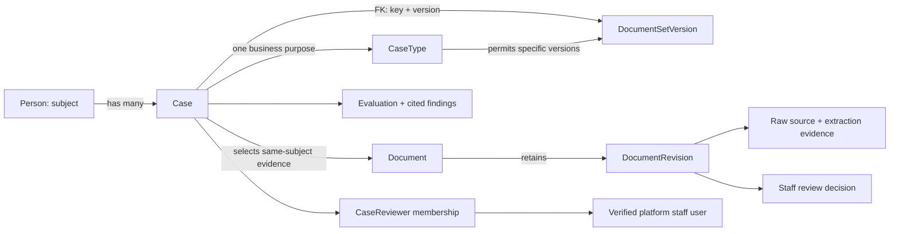

# Case ontology and shared workflow

A **Case** is one instance of a business process: opening an account, applying for
a loan, or reviewing documents. It exists independently of its evidence. Creating
it requires a subject, a CaseType and a published Document Set version.

| Object | Meaning |
| --- | --- |
| CaseType | Stable business purpose: `account_opening`, `new_loan`, or `document_review`. |
| Case | A stable UID, subject UID, type key, pinned Document Set key/version, membership revision and timestamps. |
| Document Set version | The requirements, alternatives, comparison rules and tolerances used by the shared Back Office engine. Publishing a new version does not move cases. |
| Person | The subject whose reference profile and document claims are evaluated. One subject can have multiple cases. |
| Document / revision | A subject-owned logical document and its immutable evidence revisions. A document may be selected by several cases of the same subject. |
| CaseReviewer | Independent staff responsibility. Multiple reviewers may join a case; membership does not grant permissions or accept evidence. |
| Evaluation | A retained assessment with frozen inputs, findings, citations and policy version. Later evidence changes can make it stale. |

The direct composite foreign key from Case to Document Set is mandatory. A second
composite foreign key validates that the selected version is permitted for the
chosen CaseType. The explicit type is required by the canonical creation API;
[ADR 0004](adr/0004-explicit-business-cases.md) explains the temporary nullable
storage column for older writers and retained operation intents.

## Creating and analysing a case

1. Find or create the subject. Do not substitute a reviewer identity for a subject.
2. Read `GET /case-types` and select a published policy version permitted for the
   intended business process.
3. Send `POST /cases` with `operation_key`, `subject_uid`, `case_type_key`,
   `document_set_key` and `document_set_version`.
4. Upload/process subject-owned documents using the shared document pipeline.
   The parser classifies, extracts typed claims and returns cited comparisons.
5. Link selected documents with `PUT /cases/{uid}/documents`, using the observed
   case revision. Inspect sources and record authorized document-revision reviews.
6. Run `POST /cases/{uid}/evaluations`. Back Office applies the pinned rules and
   tolerances. Comparison policies use the shared background job; others return
   synchronously. Both preserve the assessment inputs.
7. Read `/cases/{uid}/workspace` for current findings and the latest retained
   evaluation, or `/evaluations/{uid}` for an exact retained report.

A complete evidence assessment is not a loan approval or an opened account.
Case-level approval/closure and multiple subject roles are not implemented here.
The deployed helper remains read-only; this ontology does not authorize it to
create cases, upload evidence or review documents.

## Compatibility and verification

Existing assignments become cases with the same UID and references. Their physical
MetaTable binding remains `backoffice.person_document_set`; `CaseRecord` is the
canonical mapped class. `/assignments` routes remain compatibility interfaces to
the same services and preserve their response shape. There is one persistence and
evaluation engine, with no separate loan or onboarding pipeline.

`python -m scripts.verify_casework --source-uid <verified-local-uid>` exercises
explicit typed cases for both products through a verified local SQLite MetaTables
runtime. Migration/API tests cover existing-row preservation and canonical and
compatibility routes. Hosted rollout uses the deployment migration Job; local
verification does not establish production readiness.
