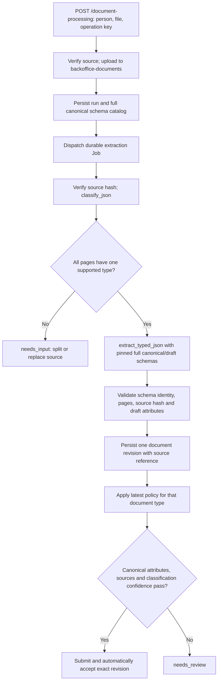

# Bucket-backed document extraction

The Back Office API now owns upload → private bucket → classification → canonical
schema extraction → acceptance. Processing runs in the `Back Office document
extraction` Main Sequence Job. The helper retains its ten read-only MCP tools.



## API

All endpoints require verified identity and the existing person/case access rules.
Operation keys are UUIDs. Provider URLs, bucket names, scores and schema objects
cannot be supplied in the upload request.

| Method and path | Input | Result |
| --- | --- | --- |
| `POST /document-processing` | Multipart `person_uid`, `operation_key`, `file` | 202 with source/run IDs, stage and status |
| `POST /source-documents/bucket-uploads` | Same multipart fields | 201 with ready source UID; no parsing |
| `POST /source-documents/{uid}/process` | JSON `{"operation_key":"<uuid>"}` | 202; process an existing ready bucket or legacy source |
| `GET /document-processing/{uid}` | Run UID | Bounded business status, classification percentage, document reference and acceptance outcome |
| `POST /document-processing/{uid}/retry` | JSON `{"operation_key":"<new retry uuid>"}` | 202; dispatch the same frozen run again |
| `GET /source-documents/{uid}/content` | Source UID | Authorized, checksum-verified original attachment |

For an upload, send one PDF, PNG or JPEG representing **one logical document**:
at most 15 MiB, 20 pages, or 50 million image pixels. Encrypted PDFs and animated
images are rejected. The request envelope is bounded at 16 MiB. Legacy chunk
upload limits remain unchanged; text sources remain readable but are not sent to
this image/PDF parser.

After an uncertain upload response, repeat the same operation key, metadata and
file. Changing any input under that key fails. The response remains 202 when Job
dispatch is unavailable and includes `dispatch_error: processing_dispatch_unavailable`;
the durable run remains pending. Retry that run after access/runtime recovery.
Never interpret 202 as extraction success.

A run moves through pending, running, completed, failed or needs_input. Its stage
records uploaded, classified, extracted, persisted or completed. `completed`
means processing finished; consult `completion.decision` for accepted/needs_review.
Mixed/unknown/unsupported classifications enter needs_input without extraction;
supply separate single-document sources instead of retrying the unchanged packet.
Failures expose bounded error codes, never provider response bodies or credentials.
Read `/documents/{document.uid}` for the persisted attributes and review history.

## Source storage and retry behavior

Bucket sources store the Main Sequence Artifact UID, bucket name, byte count and
SHA-256; `chunk_count=0` distinguishes them from legacy chunks. The adapter uses a
server-derived source UID/checksum name, reuses an existing verified object and
never intentionally replaces its content. Artifact URLs are obtained freshly from
the platform and are never persisted. Every read checks the expected length and
hash. The platform Artifact itself can be edited by its editors; this integration
detects changed bytes rather than claiming provider-level object lock/versioning.

A lost upload response is recovered by the same deterministic object name. Existing
chunk sources keep their content and identity; processing copies them to the bucket
and records the verified object reference in the run. No historical chunks are deleted.
The API shares a newly uploaded Artifact with the exact configured processor User
UIDs using its `viewer` policy, so the separate Job can read it.

The processing intent freezes the source checksum and the complete published schema
catalog before scheduling. Full nested schemas, descriptions, `$defs`, schema version
and pair checksum go to the parser. Classification pages must exactly match the
independently inspected source manifest. Extraction must return the same type,
version, schema hash, source hashes and rendered page hashes. The draft is validated
locally; the acceptance service independently runs full canonical Python validators.
The provider's `canonical_schema_valid` flag is advisory, never approval authority.

Each document's classification score is the minimum of its matching pages. Convert
0–1 to percent once, rounding down to 0.01%; no explicit type or completeness value
can manufacture confidence. The existing per-type policy decides acceptance and is
frozen in its durable completion intent. Policy edits cannot change old outcomes.

Stages checkpoint to MetaTables. A retry reuses successful classification/extraction,
creates the document under one stable operation key, and completes acceptance under
another stable key. A duplicate Job delivery cannot claim a live lease. Claims last
30 minutes, longer than the Job's 20-minute runtime ceiling; an expired claim can be
replaced, and stale or expired claims cannot update run checkpoints. A crashed Job may require
retry after its lease expires. Provider calls can repeat after a response is lost
before its checkpoint; document/review persistence remains idempotent. Retry must
use the same processor workload identity as the run's first execution.

There is no case lock while waiting for a bucket or parser. The existing short
business mutation/recovery path serializes document creation and acceptance. Generic
`/operations/{uid}/resume` deliberately refuses extraction run IDs; use the processing
retry endpoint, which cannot execute caller-supplied mutation steps.
Retry auditing uses a separate run lock so an unfinished document mutation cannot
prevent dispatching the worker that must recover it.

## Runtime configuration and access

| Setting | Default / purpose |
| --- | --- |
| `BACKOFFICE_DOCUMENT_BUCKET` | `backoffice-documents`, in the current repository Environment |
| `BACKOFFICE_PARSER_BASE_URL` | Supplied CloudFront base; hosts `/session`, or document routes in API-key mode |
| `BACKOFFICE_PARSER_FUNCTION_URL` | Supplied Lambda Function URL; must match the session response exactly |
| `BACKOFFICE_PARSER_REGION` | `eu-central-1` |
| `BACKOFFICE_PARSER_AUTH` | `sigv4`; `api_key` for a trusted HTTPS deployment using that authentication |
| `BACKOFFICE_EXTRACTION_OCR_ENABLED` | `false` explicitly selects vision-only extraction when OCR is unavailable/unsupported; `true` enables independent readers; unset preserves the default |
| `BACKOFFICE_EXTRACTION_JOB_UID` | Optional exact Job UID; otherwise resolve `Back Office document extraction` in the current branch |
| `BACKOFFICE_PARSING_PROCESSOR_UIDS` | Explicit trusted processor workload User UID allowlist, on API and Job |

The parser key is read inside each provider call from Main Sequence Secret
`AWS_BEDROOCK_FINTECHERS_APIKEY`. SigV4 uses the short-lived session credentials,
`service=lambda`, and the configured region. Redirects are disabled. Neither the
API key nor STS material enters run state, API responses, logs or tool results.

The deployment owner configures these grants in the intended Environment:

- API and extraction Job: MetaTables `backoffice` namespace `data_writer` and the
  existing MetaTables branch access. The migration Job needs namespace `editor`.
- API workload: bucket `contributor`, and `runner` on the extraction Job. The SDK
  requires Artifact ownership to grant the configured processor viewers after upload.
- Extraction Job workload: bucket `contributor` for legacy-source copies, viewer on
  API-uploaded artifacts (attached by the upload adapter), and Secret `value_reader`.
- Put the extraction Job's **workload User UID**, not its Job UID, in the processor
  allowlist. Do not grant the read-only helper any bucket, secret or processing access.

The platform enforces these grants. Missing grants remain actionable failures;
there is no fallback to an administrator or another user's credentials. Keep access
to this processing Job restricted: Main Sequence Job access can also expose artifacts
produced by its runs. There are no grant changes in the migration Job.

Workflow migration gates API deployment. The extraction Job follows its existing
automatic image deployment outside the API/agent dependency graph and reuses a
matching repository image. Its declaration does not execute a document at deployment
time. Migration revisions must remain compatible with serving extraction workers. New
uploads require the Job and its grants to be ready; configure/re-run pending dispatch
when readiness is restored. Existing helper resource access uses the current
platform `viewer` policy name; its MCP allowlist, requester verification and both
Tau exclusion flags remain unchanged.

## Verification and deployment boundary

Migration `backoffice_0005` adds bucket source metadata and worker leases, preserving
existing source/run rows. Downgrade refuses to discard bucket sources or needs_input
runs. Startup does not migrate. Hosted upgrades run through the existing migration Job.

Offline tests cover API uploads, threshold equality/below-boundary behavior, incomplete
attributes, source/schema mismatch, mixed packets, legacy source promotion, lost
bucket/draft responses, duplicate claims, expired claims, retry and authorization.
Transport tests verify exact SigV4 envelopes, bounded responses and credential redaction.

For explicit local persistence verification (development environment with tests installed):

```sh
METATABLES_LOCAL_STORAGE_DIR=/path/to/isolated/runtime \
  .venv/bin/python -m scripts.verify_document_processing --source-uid <verified-local-source-uid>
```

This verifier uses controlled bucket/parser adapters and retains synthetic fixtures
only in the explicitly selected local SQLite source. The real Main Sequence bucket
adapter was separately verified with a tiny synthetic image: upload, verified read,
and retry reused one Artifact; that artifact was deleted after the check.

On 2026-10-19 the isolated local provider applied `backoffice_0005` and a repeat was a
no-op. Actual MetaTables workflow writes/reads passed with accepted and needs_review
outcomes. The deployment workflow validator returned valid with no errors/warnings.
The full test suite passed (212 tests), along with application lint/format checks,
canonical contract checks and the unchanged ten-tool agent contract verification.

The supplied CloudFront deployment still advertised only the legacy parser routes
at verification time. Another analyst will deploy `/classify_json` and
`/extract_typed_json`. This change targets their strict ParsingMotorBackend contracts;
a live combined parser round trip and hosted Job execution remain deployment checks.

## Version 2 evidence persistence

New runs pin `parser_contract_version: 2` before dispatch. Old runs without the key
continue with v1 through the same worker. A v2 run never retries as v1 when the
provider is unavailable or returns an incompatible response. Deploy the parser's
v2 support before starting new Back Office runs; this change does not deploy either
service.

V2 adds printed pagination, source-local grouping observations, physical page
citations, reader candidates, normalization identity and usage. The worker defaults to two independent readers: ParsingMotor pairs a vision reader with
Textract (`ocr_textract`), which reports its own confidence and bounding box per candidate.
Set `BACKOFFICE_EXTRACTION_OCR_ENABLED=false` when OCR is unavailable or unsupported
for the deployment's document languages/shapes. New runs then request the parser's
vision-only `single` strategy. `true` requests `independent_readers`; omission retains
the existing default. Only `true` and `false` are valid. The legacy
`BACKOFFICE_EXTRACTION_READER_MODE=single` setting remains supported; conflicting
settings fail before dispatch. The mode is
pinned in each new run so retries and packet children cannot change strategy.
An OCR error or disagreement never silently triggers a fallback. Reprocessing with
a deliberately changed configuration creates new evidence and preserves previous
results. Both modes require canonical validation, genuine classification confidence,
source citations and the configured per-type threshold; neither calls manual review
or invents a second reader. No OCR confidence or precise
bounding box is fabricated. Coordinates refer to the rendered page after its recorded rotation.
The classifier receives `processing/classification_hints.py` descriptions (with the Czech
titles of each document) instead of the canonical schema descriptions; schemas are unchanged.

Migration `backoffice_0006` adds a nullable evidence snapshot on the existing
`document_revision` table and expands field paths to 500 characters. No product
specific table is introduced. Classification, extraction, source-name-to-UID mapping,
run identity and a content checksum are frozen with the initial revision. Candidate
locations also populate the existing `field_evidence` table. The revision and evidence
writes share one durable mutation intent: an interrupted write resumes with stable
identities, and case reads refuse unfinished intents. The hash detects content changes;
it is not a signed protocol or a tamper-proof audit chain.

`GET /documents/{uid}/revisions/{revision}/extraction-evidence` uses the existing
person/case authorization and returns `{document_uid, revision, evidence}`. Evidence
is null for manual revisions and legacy extractions. Saving a new draft does not copy
old extraction evidence; callers can explicitly retrieve the original revision.

Back Office's common acceptance service blocks automatic acceptance when citation
coverage is incomplete, reader candidates disagree, or one requested reader has no
value where another has one. Classification confidence cannot override these holds.
Canonical validation and the existing per-type acceptance policy still apply. These
are document-review decisions, never account-opening or loan approval.

For new subject-owned extraction runs, explicit document starts and continuations
can form multiple contiguous groups. Each group must have one discovered type and
consistent, complete printed pagination when supplied. An otherwise unknown boundary
can form a single-page group only when its type differs from both neighbors, the
previous document's printed pagination is complete, and the following page explicitly
starts another document. This inference is recorded in `boundary_basis`; a type change
alone is insufficient. The worker sends the entire
unchanged original with `page_selection` to `/extract_typed_json`, once per group.
Each child pins the parent's schema and reader mode, has its own classification
score and automatic acceptance result, and records its original `first_page` /
`last_page` range. No PDF splitting or reupload is required. Parent retries reuse
the same child identities and saved checkpoints. The processing response includes
`groups` and `documents` for packets, while single-document responses retain
`document`. Consumers must collect the group's documents before linking case evidence.

Unresolved boundaries, mixed types within a continuation, contradictory or incomplete
pagination, and unbound intake packets still enter `needs_input` without creating
documents from an uncertain grouping. Cross-document findings run through the same Job and evaluation service; see
[cited comparisons](document-comparisons.md). Protocols and dashboard rendering remain
subsequent work.

Local verification uses controlled provider responses through the real MetaTables API:
`scripts.verify_document_processing --source-uid <verified-local-uid>` creates fixtures;
adding `--verify-run-uid <uid>` reads and checks retained evidence in a fresh process.
It proves local persistence, not live AWS extraction quality or hosted readiness.
